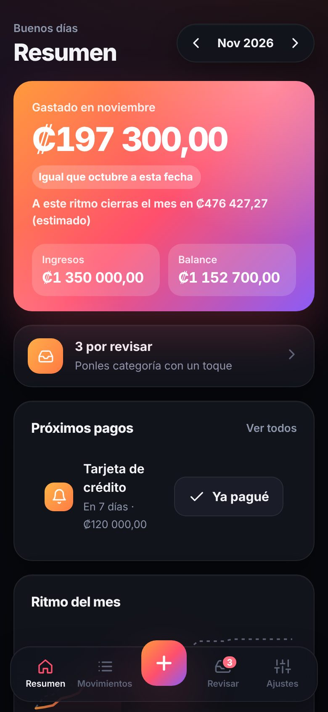
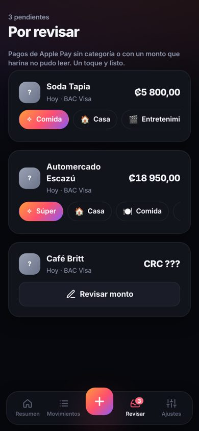
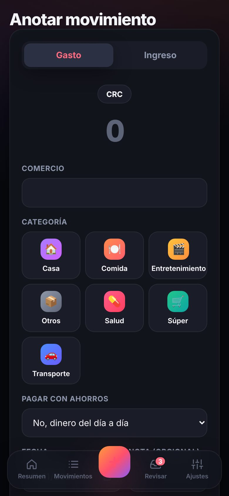
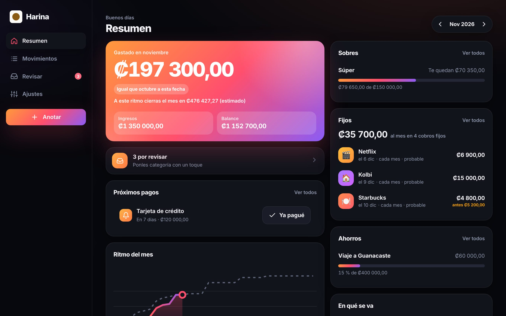

# harina

Finanzas personales para quien paga con el celular. Anota gastos e ingresos en colones y dólares, y deja que un atajo del iPhone anote solo cada pago con Apple Pay (del iPhone y, si dispara la automatización, del Apple Watch), aunque no haya señal. Sin conexión al banco, sin IA, sin rastreo.

[Read in English](README.md)

- **Servidor y web** (`src/`, `public/`): Node o Cloudflare Workers, SQLite. Entrada con llave de acceso (passkey), resumen del mes por moneda y categoría, lista por revisar y exportación.
- **App de iOS** (`ios/`): SwiftUI, iOS 17 o más reciente. La acción de Atajos «Registrar pago en harina», guardado sin señal, sincronización y Face ID.

Capturas con datos de ejemplo:

<p>
  
  
  
</p>


## Instálalo en tu máquina

Necesitas Node 22.13 o más reciente. Los datos viven en un solo archivo SQLite.

```sh
git clone https://github.com/lzno-labs/harina && cd harina
npm ci
cp .env.example .env      # pon en HARINA_ORIGIN la dirección que vas a abrir
npm start                 # la primera vez muestra un código de configuración
```

Abre `http://localhost:8787`, escribe el código y crea tu llave de acceso. Para entrar desde otros dispositivos, sírvelo con HTTPS (cualquier proxy inverso) y pon esa dirección en `HARINA_ORIGIN`: las llaves de acceso quedan atadas al nombre del servidor.

Para correrlo en Cloudflare, copia `wrangler.example.toml` a `wrangler.toml`, crea una base D1 y corre `npx wrangler d1 migrations apply harina --remote` y `npx wrangler deploy`. Detalles en el [ADR 0001](docs/adr/0001-where-it-runs.md) (en inglés).

`GET /health` responde `{"ok": true, "core": "<commit>"}` con el valor de `LZNO_CORE_SHA`.

## App de iOS

Mira [`ios/README.md`](ios/README.md): compílala con Xcode, vincúlala a tu servidor con un código de un solo uso y crea la automatización de Atajos.

## Exporta tus datos

En Ajustes, «Tus datos»: descarga todo en CSV o JSON. La app de iOS también exporta CSV. Si lo instalas tú, también puedes copiar el archivo SQLite. «Borrar todos mis movimientos» borra todo (los iPhone reciben el borrado al sincronizar).

## Desarrollo

```sh
npm test          # servidor, autenticación (WebAuthn real con un autenticador de software), sincronización, exportación
npm run lint      # ESLint, sin textos visibles en el código, mismas claves en cada idioma
swift test --package-path ios/HarinaKit   # lógica de iOS, corre también en Linux
```

Todo texto visible vive en `locales/es.json` (web) o en `ios/Harina/Resources/es.lproj/` (iOS). El español es el idioma por defecto; otro idioma es otro archivo. Las decisiones de arquitectura están en [`docs/adr/`](docs/adr/) y los diseños en [`docs/design/`](docs/design/).

## Licencia

- Servidor y web: [AGPL-3.0-only](LICENSE).
- App de iOS (`ios/`): [MPL-2.0](ios/LICENSE), para poder distribuirla por TestFlight y el App Store sin dejar de ser abierta (copyleft por archivo).

Las contribuciones son bienvenidas con DCO: mira [CONTRIBUTING.md](CONTRIBUTING.md). Reportes de seguridad: [SECURITY.md](SECURITY.md).
