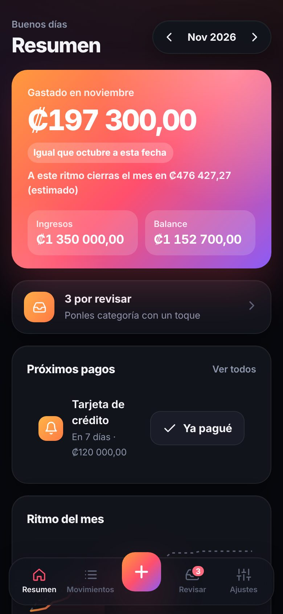
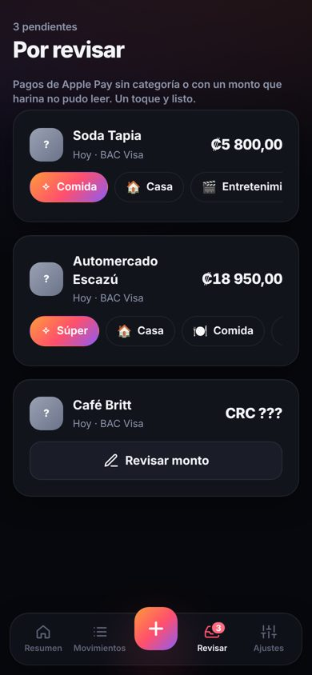
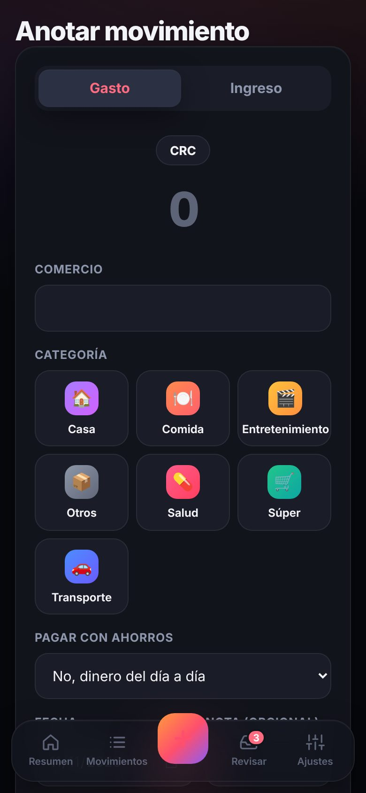
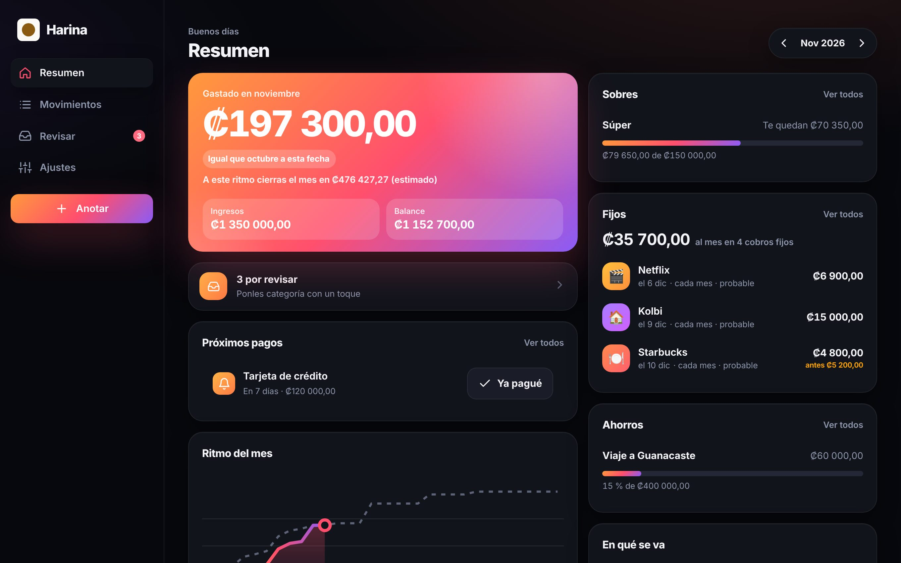

# harina

Personal finance for people who pay with their phone. Log spending and income in colones and dollars, and let an iPhone shortcut record every Apple Pay payment (iPhone and, where it triggers the automation, Apple Watch) on its own, even offline. No bank connection, no AI, no tracking.

[Leer en español](README.es.md)

- **Server and web** (`src/`, `public/`): Node or Cloudflare Workers, SQLite. Passkey sign-in, monthly summary by currency and category, review list, export.
- **iOS app** (`ios/`): SwiftUI, iOS 17+. The "Registrar pago en harina" Shortcuts action, offline storage, sync, Face ID.

Screenshots with sample data:

<p>
  
  
  
</p>


## Self-host in a few commands

Requires Node 22.13 or newer. Data lives in one SQLite file.

```sh
git clone https://github.com/lzno-labs/harina && cd harina
npm ci
cp .env.example .env      # set HARINA_ORIGIN to the address you will open
npm start                 # prints a one-time setup code on first run
```

Open `http://localhost:8787`, type the setup code and create your passkey. For access from other devices, serve it over HTTPS (any reverse proxy) and set `HARINA_ORIGIN` to that address: passkeys are bound to the hostname.

To run on Cloudflare instead, copy `wrangler.example.toml` to `wrangler.toml`, create a D1 database, then `npx wrangler d1 migrations apply harina --remote` and `npx wrangler deploy`. See [ADR 0001](docs/adr/0001-where-it-runs.md).

`GET /health` answers `{"ok": true, "core": "<commit>"}` with the value of `LZNO_CORE_SHA`.

## iOS app

See [`ios/README.md`](ios/README.md): build with Xcode, link to your server with a one-time code, and create the Shortcuts automation.

## Export your data

Settings, "Tus datos": download everything as CSV or JSON. The iPhone app also exports CSV. Self-hosters can copy the SQLite file. "Borrar todos mis movimientos" deletes everything (iPhones receive the deletion when they sync).

## Development

```sh
npm test          # server, auth (real WebAuthn with a software authenticator), sync, export
npm run lint      # ESLint, no hardcoded user-facing text, locale parity
swift test --package-path ios/HarinaKit   # iOS logic, also runs on Linux
```

Every user-facing string lives in `locales/es.json` (web) or `ios/Harina/Resources/es.lproj/` (iOS). Spanish is the default; a new language is a new file. Architecture decisions are in [`docs/adr/`](docs/adr/), designs in [`docs/design/`](docs/design/).

## License

- Server and web: [AGPL-3.0-only](LICENSE).
- iOS app (`ios/`): [MPL-2.0](ios/LICENSE), so it can be distributed through TestFlight and the App Store while staying open (file-level copyleft).

Contributions are welcome under the DCO: see [CONTRIBUTING.md](CONTRIBUTING.md). Security reports: [SECURITY.md](SECURITY.md).
